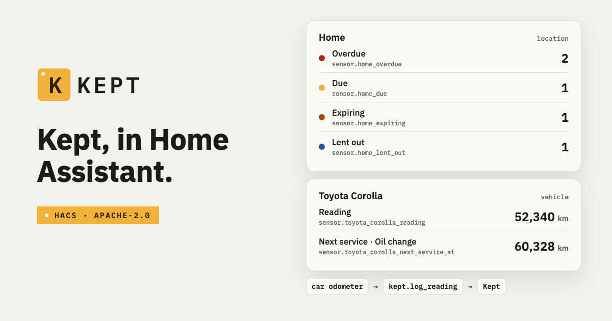
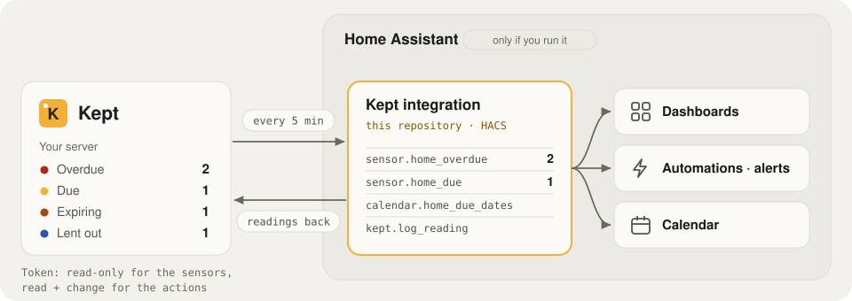

# Kept for Home Assistant



[Kept](https://github.com/keptinventory/kept) in Home Assistant: what needs you, each vehicle's
next service, and readings sent back from Home Assistant.

A custom integration, installed with HACS. Licence: Apache-2.0, the same as Home Assistant core.

## Where it sits

<picture>
  <source media="(prefers-color-scheme: dark)" srcset="docs/where-it-sits-dark.svg">
  
</picture>

- **Why:** Kept knows what's due in your home. Home Assistant is where you already look and automate.
- **What it does:** brings Kept's counts, vehicles and due dates into Home Assistant; sends readings, such as the car's odometer, back to Kept.
- **Not needed** without Home Assistant. Kept works the same on its own.

## What you get

**Per Kept location** (a home, a garage, an office), one device:

| Entity | What it shows |
|---|---|
| Overdue · Due · Expiring | Counts from Kept's Home. Attribute `items`: the first 10, most urgent first |
| Lent out · Borrowed in | Open loans. Only where Lending is on |
| Uncertain · Long unseen | Things whose place is in doubt, or not seen for the location's months |
| Low stock | Below their minimum. Only where Consumables is on |
| Unplaced · Things | Disabled at first |
| Calendar: Due dates | Kept's dated agenda as all-day events: schedules, warranties, documents, loans |

**Per vehicle**, one device under its location:

| Entity | What it shows |
|---|---|
| Reading | The latest meter reading (km, mi or hours). Attribute `meter_id` |
| Next service | The day it is due, or Kept's estimate from the readings (`estimated`) |
| Next service at | The reading it is due at |

A count Kept doesn't track in a location (the module is off) gets no sensor. A location or vehicle
added in Kept later appears after a reload of the integration.

## Actions

**`kept.log_reading`**: send a meter reading.

| Field | |
|---|---|
| `device_id` or `meter_id` | The Kept vehicle, or the meter's id (the Reading sensor's `meter_id`) |
| `value` | In the meter's unit; at most 3 decimals are kept |
| `taken_at` | Optional; now |

It shows in Kept as a reading from Home Assistant. Kept refuses a reading lower than the one
before it; the action fails with Kept's own words. A jump Kept finds unlikely is stored for review
in its Inbox (`state: needs_review` in the response).

**`kept.complete_schedule`**: mark a schedule done and record the service.

| Field | |
|---|---|
| `schedule_id` | The schedule's id in Kept (the Due dates calendar's events and the count sensors' items come from Kept's agenda) |
| `done_on` | Optional; today in the location's time zone |
| `value` | Optional; the reading, for a schedule by meter |

Both return a response (`response_variable` in a script) and need a token that can read and change.

## Kept first

The integration connects to a Kept you already run:

- **On Home Assistant OS:** install Kept as a Home Assistant app, in the same Home Assistant.
  [](https://my.home-assistant.io/redirect/supervisor_add_addon_repository/?repository_url=https%3A%2F%2Fgithub.com%2Fkeptinventory%2Fkept)
  Guide: [keptinventory.info/install/home-assistant](https://keptinventory.info/install/home-assistant/).
  Kept makes tokens only over `https`: turn on the app's **https on Kept's port** option first.
- **Anywhere else:** Docker Compose or Kubernetes: [keptinventory.info/install/compose](https://keptinventory.info/install/compose/).

The app runs Kept; this integration brings Kept's counts, due dates and vehicles into Home Assistant's
dashboards, automations and calendar. They are separate on purpose: an app can't add entities.

## Install

Needs [HACS](https://hacs.xyz/docs/use/download/download/) in Home Assistant, Kept 1.8.0 or later served over `https`, and Home Assistant able to reach Kept. Full guide: [keptinventory.info/users/home-assistant](https://keptinventory.info/users/home-assistant/).

1. HACS → ⋮ → **Custom repositories**: add `https://github.com/keptinventory/kept-homeassistant`, type **Integration**.
2. Install **Kept**, restart Home Assistant.
3. **Settings → Devices & services → Add integration → Kept**.

Needs Home Assistant 2026.10 or later, and Kept 1.8.0 or later (it adds `GET /api/v1/summary`).

## Set up

1. In Kept: **Settings → Connections → New token**. Pick the locations. **Read only** is enough for
   the sensors and the calendar; **Read and change** also lets the actions write. Kept makes tokens
   only when it is served over `https`.
2. In Home Assistant: Kept's address (`https://kept.example.org`) and the token (`kpt_…`).
   Turn off the certificate check only for a self-signed certificate on your own network.
3. The next step names the Kept version and the locations the token reaches.

Errors say what is wrong: no answer, not Kept, a redirect to `https`, an untrusted certificate,
`https` against a plain-`http` port, a revoked token, a Kept too old for the summary.

**Options** (Configure on the integration): which of the token's locations to show, and how often
to read Kept (5 minutes; 1 to 60). A token that is revoked or expires asks for a new one.

## Automation: the car's odometer into Kept

When the car integration's odometer settles (the car parked for 10 minutes), send it to Kept:

```yaml
alias: Odometer to Kept
triggers:
  - trigger: state
    entity_id: sensor.my_car_odometer
    for: "00:10:00"
conditions:
  - condition: template
    value_template: "{{ trigger.to_state.state | is_number }}"
actions:
  - action: kept.log_reading
    data:
      device_id: YOUR_KEPT_VEHICLE_DEVICE_ID
      value: "{{ trigger.to_state.state | float }}"
mode: queued
```

`sensor.my_car_odometer` is your car integration's sensor; pick the Kept vehicle in the action's
**Vehicle** field in the UI editor to fill `device_id`. The odometer's unit must be the Kept
meter's.

## How it reads Kept

Every few minutes, three calls with the token: `GET /api/v1/summary` (the counts per location),
`GET /api/v1/vehicles` and the first page of `GET /api/v1/agenda`. The calendar asks
`GET /api/v1/agenda?locationId&from&to` for the range it shows. A token reads only its own
locations, and never more than its creator may.

## Develop

```sh
uv venv --python 3.14 .venv && uv pip install --python .venv/bin/python -r requirements_test.txt
.venv/bin/ruff check custom_components tests && .venv/bin/ruff format --check custom_components tests
.venv/bin/pytest
```

The tests replay responses recorded from a seeded Kept (`tests/fixtures`).
